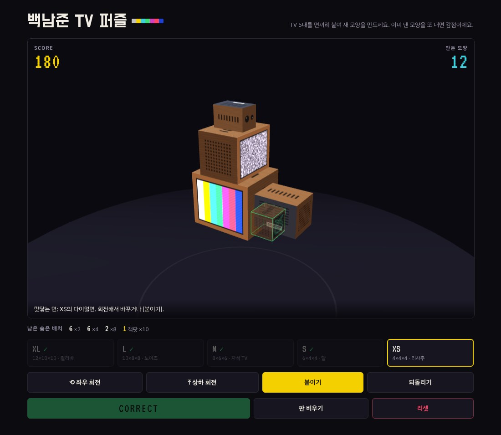
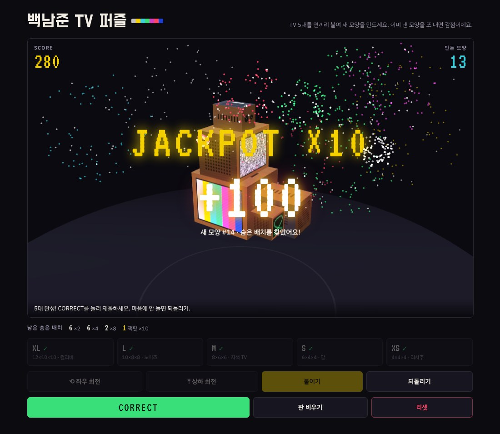
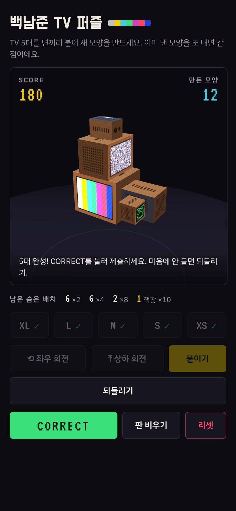

[English](README.md) | **한국어**

# 백남준 TV 퍼즐

크기가 다른 TV 5대를 돌리고 면끼리 붙여 나만의 TV 조형물을 만드는 퍼즐 + 기억력 게임입니다. 백남준의 TV 조각 작업에 대한 오마주예요.

**플레이:** https://steves460ng.github.io/paik-tv-puzzle/



## 앱으로 설치하기 (오프라인 플레이)

백남준 TV 퍼즐은 PWA예요. 설치하면 홈 화면에서 앱처럼 열리고, **인터넷 없이도** 플레이할 수 있어요.

| 기기 | 설치 방법 |
|---|---|
| **iPhone / iPad** (Safari) | 플레이 링크 열기 → **공유** 버튼 → **홈 화면에 추가** → **추가** |
| **안드로이드** (Chrome) | 플레이 링크 열기 → 뜨는 **앱 설치** 안내를 누르거나 **⋮ 메뉴 → 앱 설치** (예전 버전은 **홈 화면에 추가**) |
| **Windows / Mac** (Chrome, Edge) | 플레이 링크 열기 → 주소창 오른쪽 끝의 **설치 아이콘** 클릭, 또는 **⋮ 메뉴 → 전송, 저장, 공유 → 페이지를 앱으로 설치** |
| **Mac** (Safari 17 이상) | 플레이 링크 열기 → **파일 → Dock에 추가** |

**오프라인으로 쓰기 전에** 인터넷이 연결된 상태에서 게임을 한 번 열어 주세요. 첫 접속 때 게임이 기기에 저장되고, 그다음부터는 오프라인에서도 열려요.

- 업데이트: 온라인 상태에서 앱을 열면 최신 버전을 알아서 받아요.
- 점수와 기록은 설치한 앱에도 유지돼요. iPhone에서는 설치한 앱과 브라우저 탭의 기록이 따로 저장되고, 다른 기기에서는 보통 같이 써요.
- 삭제는 다른 앱처럼 하면 돼요 (아이콘 길게 누르기 → 삭제).

## 목표

매번 **새로운 모양**의 조형물을 만들어 제출하세요. 이미 만든 모양을 다시 내면 감점됩니다. 지금까지 낸 모양은 보여 주지 않으니 기억해야 해요.

## 화면 구성

- **좌측 상단 SCORE**: 현재 점수
- **우측 상단 만든 모양**: 지금까지 인정받은 서로 다른 모양의 개수
- **아래 TV 목록**: XL · L · M · S · XS 다섯 대 (붙인 TV는 ✓ 표시)

## TV의 여섯 면

면마다 생김새가 달라서 어느 쪽이 어디를 향하는지 알 수 있어요.

| 면 | 생김새 |
|---|---|
| 화면 | 영상이 나오는 앞면 |
| 뒤판 | 회색 판에 통풍구와 라벨 |
| 다이얼면 | 나무 옆면에 손잡이 2개 |
| 스피커면 | 나무 옆면에 스피커 구멍 |
| 윗면 | 밝은 나무에 통풍 슬롯 |
| 밑면 | 어두운 판에 고무발 4개 |

각 TV 화면에는 서로 다른 영상이 나와요: XL 컬러바, L 노이즈, M 자석 TV, S 달, XS 리사주.

## 게임 방법

1. **첫 TV 놓기**: TV 목록에서 하나를 고르고 `좌우 회전` · `상하 회전`으로 자세를 정한 뒤 `놓기`를 누릅니다.
2. **붙일 면 고르기**: 다음 TV를 고르고, 이미 놓인 TV에서 붙일 면을 탭(클릭)합니다. 붙을 자리에 반투명 TV가 나타나요.
3. **맞닿을 면 고르기**: 회전 버튼으로 새 TV의 어느 면이 맞닿을지 정합니다. 아래 안내줄에 "맞닿는 면"이 표시돼요.
4. **붙이기**: 테두리가 초록색이면 `붙이기`를 누릅니다. 빨간색이면 다른 TV와 겹친다는 뜻이라 붙일 수 없어요.
5. **제출**: 5대를 모두 붙이면 `CORRECT`를 누릅니다.

한 TV에 여러 TV를 붙여 가지를 쳐도 됩니다. TV 5대는 모두 이어져 있어야 해요.

## 점수

| 결과 | 점수 |
|---|---|
| **CORRECT**: 처음 만든 모양 | +10 |
| **UNCORRECT**: 이미 만든 모양 | −5 |

CORRECT가 나오면 판이 비워지고 다음 판이 시작돼요. UNCORRECT가 나오면 판이 그대로 남아 있어서 고쳐서 다시 낼 수 있어요.

### 같은 모양의 기준

- 버튼을 누른 순서가 아니라 **완성된 최종 모양**으로 판정해요.
- 조형물 **전체를 통째로 돌렸을 때 같아지면** 같은 모양이에요.
- **거울에 비친 모양**은 다른 모양으로 인정해요.

## 숨은 배치 (잭팟)

게임을 처음 시작할 때와 리셋할 때마다 **숨은 배치 23개**가 무작위로 정해져요. 숨은 배치마다 그에 해당하는 조형물들이 무작위로 정해지고, 어떤 모양인지는 화면에 나오지 않아요.

새 모양으로 CORRECT를 냈을 때 그 모양이 숨은 배치에 해당하면 기본 10점 대신 배수 점수를 받고 폭죽이 터져요. 같은 모양은 같은 게임 안에서 항상 같은 결과를 내요.

| 등급 | 개수 | 보상 | 당첨 확률 (숨은 배치 1개, 제출 1회 기준) |
|---|---|---|---|
| ×2 | 10 | +20 | 약 1/27 |
| ×4 | 8 | +40 | 약 1/67 |
| ×8 | 4 | +80 | 1/200 |
| **잭팟 ×10** | 1 | **+100** | 약 1/333 |

현재 배율(`JACKPOT_FACTOR`)은 0.3이에요. 게임 2만 판 시뮬레이션 기준으로 첫 10회 제출 중 약 38%에서 보너스가 나오고, 잭팟은 100회 안에 만날 확률이 약 26%예요.

- 한 번 제출에 여러 개가 걸리면 가장 높은 배수 하나만 받아요.
- 찾은 숨은 배치는 사라져요. 남은 개수는 작업대 아래에 표시돼요.
- UNCORRECT(이미 만든 모양)에는 잭팟이 적용되지 않아요.
- 게임 초반에는 숨은 배치가 많이 깔려 있어서 자주 걸리고, 찾을수록 점점 드물어져요.



### 확률 조정

`index.html`의 스크립트 맨 위 **잭팟 설정** 블록에서 숫자만 바꾸면 돼요.

```js
const JACKPOT_FACTOR = 0.3;          // 모든 확률에 곱하는 배율 (2 = 두 배, 0.5 = 절반)
const JACKPOT_TIERS = [
  { mult: 2,  count: 10, chance: 1 / 8 },
  { mult: 4,  count: 8,  chance: 1 / 20 },
  { mult: 8,  count: 4,  chance: 1 / 60 },
  { mult: 10, count: 1,  chance: 1 / 100 }
];
```

- `chance`: 숨은 배치 1개가 새 모양 제출 1회에 걸릴 확률
- `count`: 깔리는 개수 / `mult`: 기본 10점에 곱하는 배수
- 설정을 바꾸면 다음 접속 때 숨은 배치를 새로 뽑아요. 점수와 기록은 유지돼요.

## 버튼

| 버튼 | 기능 |
|---|---|
| 좌우 회전 / 상하 회전 | 고른 TV를 90도씩 돌림 |
| 놓기 / 붙이기 | TV를 그 자리에 고정 |
| 되돌리기 | 마지막에 붙인 TV를 떼어냄 |
| 판 비우기 | 지금 판의 TV를 모두 치움 (점수 유지) |
| 리셋 | 점수와 기록을 모두 0으로 하고 숨은 배치를 새로 뽑음 (두 번 눌러야 작동) |

## 조작

- **시점 돌리기**: 빈 곳을 드래그 (모바일은 한 손가락)
- **확대·축소**: 마우스 휠 또는 두 손가락 핀치
- **면 고르기**: 짧게 탭 또는 클릭



## 참고

- 점수, 기록, 숨은 배치는 사용하는 브라우저에 저장돼요. 새로고침해도 숨은 배치는 바뀌지 않아요. 다른 기기나 브라우저에서는 0점부터 시작합니다.
- WebGL을 지원하는 최신 브라우저가 필요해요.
- 개발자 참고: 오프라인 실행을 위해 three.js와 폰트를 `vendor/`에 넣어 두었어요. `sw.js` 목록에 있는 파일을 바꾸면 `CACHE` 값을 올려 주세요 (예: `paik-tv-v2`). 그래야 설치된 앱에도 반영돼요. `index.html`만 바꾼 경우에는 자동으로 반영돼요.
- 폰트: Do Hyeon, IBM Plex Sans KR, VT323은 SIL Open Font License 1.1, three.js는 MIT 라이선스예요. 라이선스 전문은 `vendor/`에 있어요.
- 기기(브라우저) 언어가 한국어면 한국어로, 그 밖의 언어면 영어로 안내 문구가 나와요.
