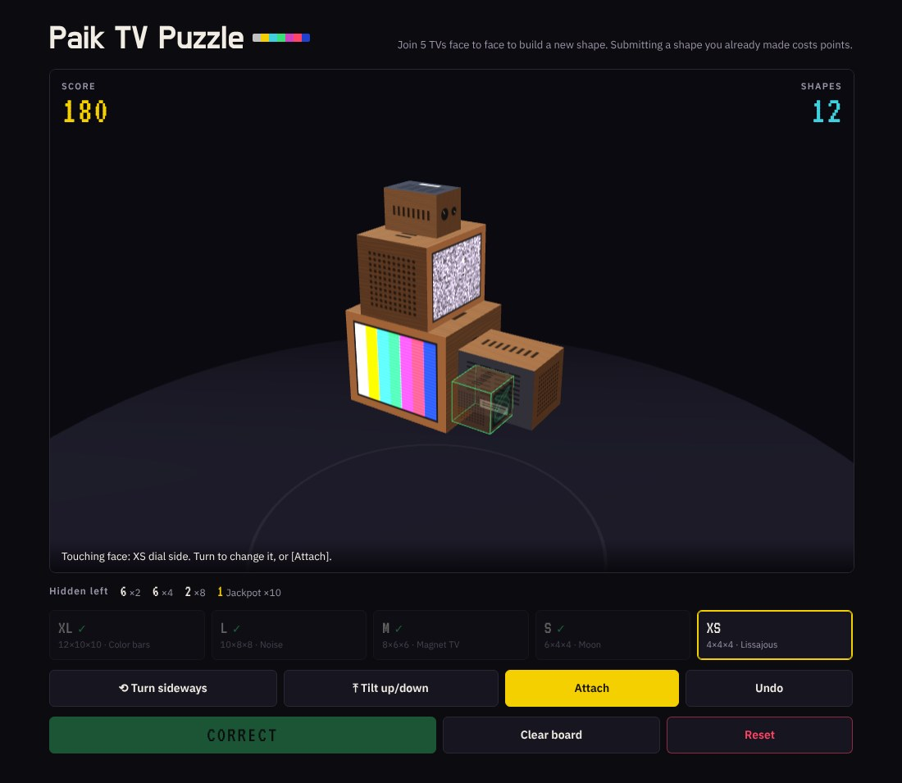
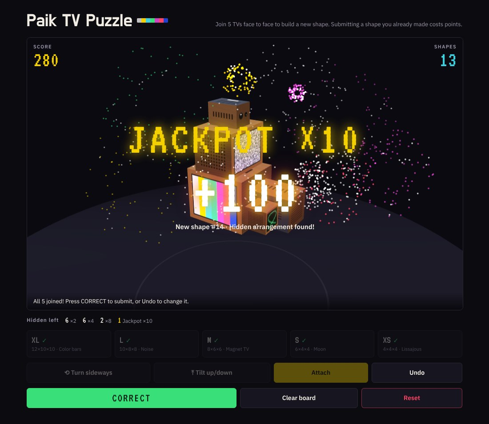
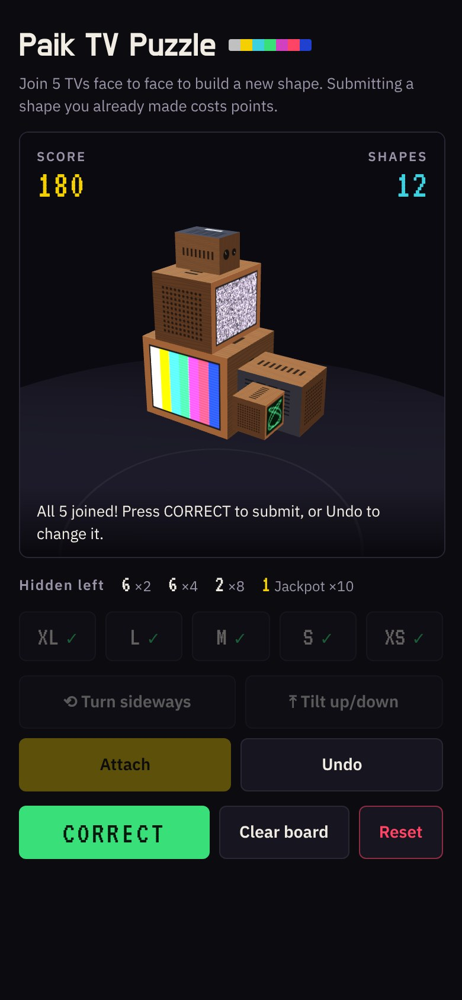

**English** | [한국어](README.ko.md)

# Paik TV Puzzle

A puzzle and memory game: turn five TVs of different sizes and join them face to face to build your own TV sculpture. An homage to Nam June Paik's TV sculptures.

**Play:** https://steves460ng.github.io/paik-tv-puzzle/



## Install as an app (play offline)

Paik TV Puzzle is a PWA. Once installed, it opens from your home screen like an app and plays **without an internet connection**.

| Device | How to install |
|---|---|
| **iPhone / iPad** (Safari) | Open the play link → tap the **Share** button → **Add to Home Screen** → **Add** |
| **Android** (Chrome) | Open the play link → tap **Install app** when it pops up, or **⋮ menu → Install app** (older versions: **Add to Home screen**) |
| **Windows / Mac** (Chrome, Edge) | Open the play link → click the **install icon** at the right end of the address bar, or **⋮ menu → Cast, save and share → Install page as app** |
| **Mac** (Safari 17+) | Open the play link → **File → Add to Dock** |

**Before you go offline**, open the game once while connected. It saves itself on your device on that first visit, and after that it opens offline too.

- Updates: when you open the app while online, it picks up the latest version by itself.
- Score and history are kept in the installed app. The installed app and the browser tab keep separate records on iPhone; on other devices they usually share them.
- To uninstall, remove it the way you remove any other app (long-press the icon → Remove).

## Goal

Build and submit a **new shape** every time. Submitting a shape you already made costs points. Your past shapes are never shown, so you have to remember them.

## Screen

- **SCORE (top left)**: your current score
- **SHAPES (top right)**: how many different shapes you have had accepted
- **TV list (bottom)**: five TVs, XL · L · M · S · XS (a ✓ marks the ones already joined)

## The six faces of a TV

Each face looks different, so you can always tell which way a TV is facing.

| Face | Looks like |
|---|---|
| Screen | The front, playing video |
| Back | Grey panel with vents and a label |
| Dial side | Wooden side with two knobs |
| Speaker side | Wooden side with speaker holes |
| Top | Light wood with vent slots |
| Bottom | Dark panel with four rubber feet |

Each screen plays its own programme: XL color bars, L noise, M Magnet TV, S moon, XS Lissajous.

## How to play

1. **Place the first TV**: pick one from the TV list, set its pose with `Turn sideways` and `Tilt up/down`, then press `Place`.
2. **Pick where it goes**: pick the next TV, then tap (or click) a face on a TV that is already placed. A see-through TV appears where it will attach.
3. **Pick which face touches**: use the turn buttons to choose which face of the new TV touches. The hint line at the bottom shows the "Touching face".
4. **Attach**: when the outline is green, press `Attach`. Red means it would overlap another TV, so it can't go there.
5. **Submit**: once all five are joined, press `CORRECT`.

You can attach several TVs to one TV and let the sculpture branch out. All five TVs must be connected.

## Scoring

| Result | Points |
|---|---|
| **CORRECT**: a shape you haven't made before | +10 |
| **UNCORRECT**: a shape you already made | −5 |

After CORRECT the board clears and the next round starts. After UNCORRECT the board stays as it is, so you can change it and try again.

### What counts as the same shape

- The **finished shape** is judged, not the order of button presses.
- If **turning the whole sculpture** makes two shapes match, they are the same shape.
- A **mirror image** counts as a different shape.

## Hidden arrangements (jackpots)

When a game starts, and on every reset, **23 hidden arrangements** are drawn at random. Each one secretly matches a random set of sculptures, and none of them are shown on screen.

When you submit a new shape with CORRECT and it matches a hidden arrangement, you get a multiplied score instead of the usual 10 points, with fireworks. Within one game, the same shape always gives the same result.

| Tier | Count | Reward | Chance (per hidden arrangement, per submission) |
|---|---|---|---|
| ×2 | 10 | +20 | about 1/27 |
| ×4 | 8 | +40 | about 1/67 |
| ×8 | 4 | +80 | 1/200 |
| **Jackpot ×10** | 1 | **+100** | about 1/333 |

The current factor (`JACKPOT_FACTOR`) is 0.3. In a simulation of 20,000 games, about 38% of the first 10 submissions earned a bonus, and about 26% of players hit the jackpot within 100 submissions.

- If one submission matches several, you get only the highest multiplier.
- A found arrangement is used up. The number left is shown under the workbench.
- UNCORRECT (a shape you already made) never wins a jackpot.
- Early in a game many arrangements are still hidden, so bonuses come often; they get rarer as you find them.



### Tuning the odds

Change the numbers in the **jackpot settings** block at the top of the script in `index.html`.

```js
const JACKPOT_FACTOR = 0.3;          // multiplies every chance (2 = double, 0.5 = half)
const JACKPOT_TIERS = [
  { mult: 2,  count: 10, chance: 1 / 8 },
  { mult: 4,  count: 8,  chance: 1 / 20 },
  { mult: 8,  count: 4,  chance: 1 / 60 },
  { mult: 10, count: 1,  chance: 1 / 100 }
];
```

- `chance`: the chance that one hidden arrangement matches one new submission
- `count`: how many are drawn / `mult`: what the base 10 points are multiplied by
- After you change the settings, new hidden arrangements are drawn on the next visit. Score and history are kept.

## Buttons

| Button | What it does |
|---|---|
| Turn sideways / Tilt up/down | Turns the selected TV 90° |
| Place / Attach | Fixes the TV in place |
| Undo | Removes the last TV you joined |
| Clear board | Removes all TVs from this round (score is kept) |
| Reset | Sets score and history to 0 and draws new hidden arrangements (press twice) |

## Controls

- **Orbit the view**: drag on empty space (one finger on mobile)
- **Zoom**: mouse wheel or two-finger pinch
- **Pick a face**: short tap or click



## Notes

- Score, history and hidden arrangements are saved in your browser. Reloading does not change the hidden arrangements. On another device or browser you start from 0.
- Needs a recent browser with WebGL.
- For developers: three.js and the fonts are bundled in `vendor/` so the game runs offline. If you change any file listed in `sw.js`, bump `CACHE` (for example `paik-tv-v2`) so installed copies update. Changes to `index.html` alone reach players automatically.
- Fonts: Do Hyeon, IBM Plex Sans KR and VT323 under the SIL Open Font License 1.1. three.js under the MIT License. Licence texts are in `vendor/`.
- Messages appear in Korean when the device (browser) language is Korean, and in English otherwise.
